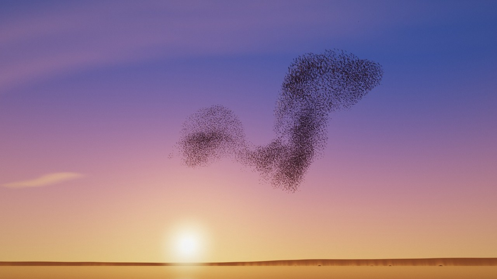

# Murmuration

A starling murmuration, and a school of fish, simulated on the graphics card in one HTML file.

**Live: <https://xlt.pw/murmuration/>**

Tens of thousands of birds, each steering by its seven nearest neighbours. Nothing about the shape is
scripted: the ribbons, folds and waves come out of the rules. Falcons and hawks visit and hunt, and you
can be one.

## Run it

Open `index.html` in a browser. There is no build step, no dependency and no network request (the two
typefaces are embedded). It needs WebGL2 with float render targets, which current desktop browsers have.

## Controls

| Tool or input | What it does |
|---|---|
| **Hunter** | Your pointer is a falcon (or a shark). The flock dodges it; click to dive. |
| **Startle** | Click near the flock to send a panic wave from that spot. |
| **Lure** | The flock is drawn toward your pointer. |
| **Add hunter** | Click to release a wild hawk, falcon, shark or tuna. |
| **Inspect** | Right-click, or pick the tool and click, one bird to see its traits and ride along with it. |
| **Mouse** | Drag to walk around the flock's home, scroll to zoom. |
| **Touch** | One finger uses the tool, two fingers walk around, pinch to zoom. |
| **Keys** | `1`–`9`, `0` scenes · `V` view · `R` reseed · `N` new sky · `H` hide panel · `Space` pause · `F` full screen |

**Tune** (top right) has the scenes (seven for starlings, three for fish), flock size, tightness,
restlessness, time of day and, under *Fine tuning*, every rule's strength. Each seed gives a different
flock, sky and pattern of hunter visits.

## As a screensaver or wallpaper

Add `?screensaver` to the address: <https://xlt.pw/murmuration/?screensaver>. That hides every control,
ignores the pointer and runs on Eco power (30 frames a second, about 8,000 birds). Wild hunters still
visit and the scene changes every few minutes.

- `?screensaver&power=balanced` or `&power=high` for more birds and a higher frame rate.
- `?screensaver#blue-hour` (or any scene's name) to start on that scene.

Apps that show a web page as a screensaver or wallpaper can point at that address, or at a downloaded
copy of `index.html`:

- **macOS:** [WebViewScreenSaver](https://github.com/liquidx/webviewscreensaver)
- **Windows:** [Lively Wallpaper](https://github.com/rocksdanister/lively) (wallpaper or screensaver)
- **Steam:** Wallpaper Engine, as a web wallpaper

None of these three has been tried yet. If one fails, please open an issue.

## How it works

- **State lives on the GPU.** Position, velocity and a few traits per bird sit in floating-point
  textures; every rule is a fragment shader that reads one frame's textures and writes the next.
- **Nearest neighbours, not everyone in range.** Each bird tracks its seven or so nearest neighbours,
  found through a hash grid, however far apart the flock is spread. Real starlings do the same
  (Ballerini et al. 2008).
- **The rules.** Keep your space, match your neighbours' heading and pace, close up when you fall behind,
  ease off out in front, and drift back toward the bulk of the flock and the roost. Birds differ a little
  in size, pace, boldness and sociability, and their mood drifts.
- **Turns travel.** A bird that turns is copied by its neighbours 45 to 140 ms later, so a turn crosses
  the flock as a wave at 22 to 24 m/s. Field measurements put that speed at 20 to 40 m/s (Attanasi et al.
  2014).
- **Alarm travels too.** A startled bird startles its neighbours, so a pulse runs away from an attacking
  falcon, the model's version of the waves filmed in real flocks under attack (Procaccini et al. 2011).
- **Hunters.** A peregrine circles above, stoops through the edge of the flock at 46 m/s, pulls out
  below and climbs back. Hawks give chase. For fish there are sharks and tuna.
- **Drawing.** Each bird is a small jointed mesh that flaps, banks and glides, lit by the scene's sun and
  shadowed by the birds between it and the light. Far-off birds shrink to dark silhouettes.

## How it was tuned

Six clips of real murmurations were reduced to silhouette statistics: how elongated the flock is, how
dark, how solid, how many separate bodies, and how fast the outline changes. Each build was then
measured the same way (32,768 birds, 40 seconds, several seeds) and compared. Flight speed is 10.6 m/s,
inside the 7 to 12 m/s reported for real flocks (Attanasi et al. 2014).

## Known limits

- The outline changes less than in real footage: 0.3 to 0.4 of the silhouette per second against about
  0.45.
- The flock splits into two or three bodies and re-merges more often than real flocks do.
- Birds fly about 30% closer together than measured flocks. With tens of thousands of birds instead of
  hundreds of thousands, real spacing reads as pale dots rather than a dark sheet.
- Runs differ even with the same seed, so the measurements above are noisy.
- So far it has only been run in Chromium browsers. Safari, Firefox and phones are untested.

## Performance

*Power use* in the panel has three levels: Eco (30 frames a second, about 8,000 birds), Balanced (60,
about 16,000) and High (uncapped, about 32,000 at full resolution). Each seed varies the count, as real
flocks vary. If the frame rate stays low, the
page flies fewer birds and then lowers its resolution on its own. *Performance*, at the bottom of the
panel, shows the frame rate, the slowest recent frame, the graphics chip in use and what was lowered.

## References

- Ballerini, M. et al. (2008). Interaction ruling animal collective behavior depends on topological
  rather than metric distance: evidence from a field study. *PNAS* 105(4), 1232–1237.
- Attanasi, A. et al. (2014). Information transfer and behavioural inertia in starling flocks.
  *Nature Physics* 10, 691–696.
- Procaccini, A. et al. (2011). Propagating waves in starling, *Sturnus vulgaris*, flocks under
  predation. *Animal Behaviour* 82(4), 759–765.

## Credits and licence

Made by [Xavier Torgerson](https://xlt.pw).

The code is under the [MIT licence](LICENSE). The embedded typefaces, Fraunces and Instrument Sans, are
under the SIL Open Font License 1.1 (see [`LICENSES/`](LICENSES)).
